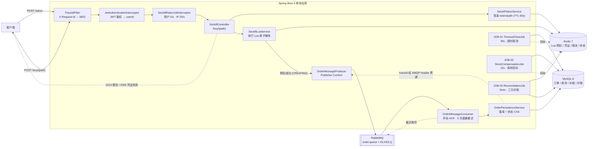

# Flash-sale-system

> 一个从零迭代四版（v1→v4）的单体秒杀系统，用可复现的压测数据记录每一步架构取舍。

## 1. 项目简介与定位

**一句话**：用四个可交付版本，把一个"能下单"的单体秒杀，逐步演进为"防刷、防超卖、可补偿、可对账、可观测"的高并发系统，每个版本都有压测报告与复盘文档佐证。

**一段话**：本项目以"单活动、限量库存"的秒杀场景为载体，按 v1→v4 迭代：v1 用 MySQL 条件扣减 + 唯一索引完成基础闭环（QPS 152.6）；v2 引入 Redis Lua 原子预扣 + RabbitMQ 异步落库，把下单主链路从数据库热点行锁中解放出来（QPS 393.7）；v3 增加 token/path 秒杀凭证与 Redis 滑动窗口限流，抵御脚本与重放（buy 受理 QPS 469.5）；v4 补齐超时取消、库存回补、三方对账与可观测三件套（traceId 跨 MQ、慢 SQL 日志、Micrometer 指标），buy 受理 QPS 中位 303.1（受 Windows 压测宿主机环境干扰，跨天不可比，详见 §7）。项目刻意不做微服务、不引入分布式事务框架，用最少的组件把"防超卖 / 幂等 / 可靠投递 / 限流 / 对账"这些核心问题讲清楚——**它的价值是完整的设计闭环与诚实的数据，而非绝对吞吐量**。

## 2. 架构图（v4 全链路）



> 说明：`Ctrl → LuaSvc → Redis` 为下单主路径的第一道防线，全部在 Redis 单线程内原子完成；`MQ → Consumer → MySQL` 为异步落库路径；三个定时任务（JOB-01/02/03）负责超时、补偿与对账兜底。traceId 经 AMQP message header 从 Producer 透传到 Consumer（见 §5 / ADR-021）。

## 3. 技术栈

| 分类 | 选型 | 说明 |
|---|---|---|
| 语言 / 运行时 | Java 17 | Spring Boot 3 要求 |
| 框架 | Spring Boot 3.4.5 | Web / Validation / Actuator |
| 数据库 | MySQL 8.0 | 订单、库存、补偿、对账的权威存储 |
| 缓存 | Redis 7 | Lua 预扣、凭证、限流、订单状态 |
| 消息队列 | RabbitMQ 3（management） | 异步落库、DLX/DLQ、Publisher Confirm |
| ORM | MyBatis-Plus 3.5.12 | |
| 数据库迁移 | Flyway | `db/migration/V1__init_schema.sql` |
| 连接池 | HikariCP | `maximum-pool-size=10`（压测瓶颈之一） |
| 鉴权 | jjwt 0.12.6 + jbcrypt 0.4 | JWT 鉴权 + BCrypt 密码 |
| API 文档 | springdoc-openapi 2.8.6 | Swagger UI |
| 可观测 | Spring Boot Actuator + Micrometer | `/actuator/metrics`，无 Prometheus/Grafana |
| 配置管理 | spring-dotenv 4.0.0 | 读取 `.env` |
| 压测 | Apache JMeter 5.6.3 | JTL 日志分析脚本用 Python 3 |
| 容器化 | Docker / Docker Compose | MySQL + Redis + RabbitMQ + App |

## 4. 核心功能

- **用户与鉴权**：登录签发 JWT（BCrypt 校验密码），后续接口经 `JwtAuthenticationInterceptor` 解析 userId。
- **商品与活动**：活动列表、详情，活动状态 `NOT_STARTED / ONGOING / ENDED / PAUSED`。
- **秒杀凭证**：`POST /token` 签发一次性 `seckillToken + path`（TTL 60s），`POST /buy/{path}` 消费凭证。
- **秒杀下单**：Redis Lua 原子完成"凭证校验 → 限购 → 库存预扣 → 写 CREATING 状态"，再异步投递 MQ。
- **订单查询**：按订单号查询状态，返回 `CREATING / UNPAID / PAID / CLOSED_TIMEOUT / FAILED`。
- **模拟支付**：`POST /pay` 将 `UNPAID → PAID`（状态 CAS）。
- **限流**：用户维度 5/秒、IP 维度 20/秒，Redis ZSET 滑动窗口，超限返回 `2013 / HTTP 429`。
- **超时取消（JOB-01）**：`UNPAID` 超时（默认回拨验证用）批量关闭为 `CLOSED_TIMEOUT`。
- **库存回补（JOB-02）**：对需补偿订单回补库存，指数退避重试 + 告警。
- **三方对账（JOB-03）**：比对 Redis 预扣口径与 MySQL 落库口径，双 diff 非零告警（只告警不改数）。
- **可观测**：traceId 跨 MQ 贯通、慢 SQL 日志（默认 500ms 阈值）、Micrometer 关键指标。

## 5. 关键设计（5 个 ADR 摘要）

### 5.1 防超卖：三道防线（ADR_DDL / 设计文档）

1. **Redis Lua 原子预扣**：`seckill_full.lua` 在 Redis 单线程内一次性完成凭证校验、限购计数、库存 `DECR` 与 CREATING 写入，天然无并发超卖。
2. **MySQL 条件扣减**：落库回写库存走 `UPDATE ... SET available_stock = available_stock - 1 WHERE id = ? AND available_stock >= 1`，行锁 + 条件判断兜底，影响行数为 0 即拒绝。
3. **唯一索引约束**：`order_no` 唯一索引 + `uk_compensation_order_type`，从数据层杜绝重复订单与重复补偿。

> 为什么不用分布式锁：Redis Lua 已是单线程原子，热点路径上再叠一层分布式锁只会增加锁竞争与故障释放复杂度，收益为负（见 §12 Q1）。

### 5.2 幂等：唯一键 + 状态 CAS（ADR-010）

- **下单幂等**：`order_no` 唯一索引，重复插入触发 `DuplicateKeyException`，由 `DuplicateKeyResolver` 统一转为业务码 `2010`（重复下单）。
- **状态迁移幂等**：所有状态流转用 `UPDATE ... WHERE status = ?` 的条件更新（CAS），避免并发重复推进。
- **补偿幂等**：`stock_compensation` 表以 `(order_no, compensation_type)` 唯一键约束，"一次订单一种补偿只允许成功一次"。
- **CREATING 悬挂补偿**：`CreatingCompensationJob` 清理 Redis 中长时间停留的 CREATING（`reclaimStale` 5min 判死）。

### 5.3 MQ 可靠性：Confirm + 手动 ACK + DLQ（ADR-016 / 设计文档）

- **发送侧**：开启 Publisher Confirm，`handleConfirm` 中 `ack=true` 计 `mq.send.success`，`nack` / 异常回滚 Redis 预扣并计 `mq.send.fail`。
- **消费侧**：手动 ACK；处理异常走固定退避重试（100ms → 500ms → 1s，`MAX_ATTEMPTS=3`），重试耗尽后 `basicNack(requeue=false)` 投递到 DLX/DLQ。
- **不确定窗口**：Publisher Confirm 存在"消息已到 broker 但 confirm 未回"的窗口（ADR-016），此时 Redis 已回滚为 FAILED，由对账与补偿任务兜底。

### 5.4 限流：Redis ZSET 滑动窗口（ADR-018）

- 用户维度 `seckill:limit:user:{userId}:{activityId}`（默认 5/秒）、IP 维度 `seckill:limit:ip:{ip}`（默认 20/秒）。
- 同一 Lua 内先清理窗口外成员，再双维度计数判断，**都未超限才写入**，超限不扣库存、不进入 MQ。
- Redis 不可用时 **fail-close**，返回 `5002`，不允许绕过限流。
- 商品维度限流本批不启用（活动 ID 已含在用户维度）。

### 5.5 对账：双口径比对 + 在途豁免（ADR-020）

- 对账恒等式：`redis_diff = total_stock - redis_stock - sold_quantity`（同法算 `mysql_diff`）。
- 仅扫描 `ONGOING` 活动；`result` tinyint（0 一致 / 1 疑似超卖 / 2 疑似少卖）。
- **在途豁免**只对 `PENDING` / `COMPENSATING` 状态订单视作在途（**不含 FAILED**），避免误报。
- **只告警不改数**：异常落 append-only 的 `reconciliation_record`，由人工按 SOP 处理，绝不自动写回库存。

## 6. 版本演进对比表（v1~v4）

| 版本 | 核心能力 | QPS | P99 | 统计口径 / 备注 |
|---|---|---|---|---|
| **v1** | 基础闭环：MySQL 条件扣减 + `order_no` 唯一索引 | **152.6** | **1304ms**（P95 1293ms） | 端到端；200 线程 / ramp 1s / sync timer 200，库存 100 |
| **v2** | Redis Lua 原子预扣 + RabbitMQ 异步落库 | **393.7** | **501ms**（P95 496ms） | 端到端；**501ms 超 500ms 目标 1ms，属临界未通过** |
| **v3** | token/path 秒杀凭证防刷 + Redis 滑动窗口限流 | **469.5** | **397ms**（buy P95 382ms） | **buy 受理口径**；副口径端到端整体 QPS 199.6，token 分项 732.6 |
| **v4** | 超时取消 + 库存回补 + 三方对账 + 可观测 | **303.1** | **660.6ms**（P95 624.6ms） | buy 受理口径；**受 Windows 压测宿主机环境干扰，跨天不可比**（详见 §7） |

> 口径提醒：**v3/v4 的 QPS 是 "buy 受理口径"**（只统计 `/buy/{path}` 请求的 span），而 **v1/v2 是端到端口径**。因此 v2→v3 的 "+19%" 是同口径（buy）下的对比，但 v1→v2、v2→v3 的整体端到端数字不可直接相减。所有数字均取自各版本压测报告的正式轮次中位数。

## 7. 压测报告摘要

### 7.1 统计口径说明（buy 受理口径）

v3 起引入 **buy 受理口径**：QPS 以 JMeter JTL 中 `/buy/{path}` 请求的 span 计算，`span = max(timeStamp+elapsed) − min(timeStamp)`。原因是 v3 的下单链路被拆为"取凭证 + 购买"两个动作，端到端整体 QPS 会把 token 签发（分项 QPS 732.6）混进来，无法反映真正的下单吞吐。v1/v2 未拆分，故为端到端口径。**跨版本比较时务必确认口径是否一致。**

### 7.2 各版本结论

- **v1（QPS 152.6 / P99 1304ms）**：6 轮压测（r0 预热，r1 因 53 次连接拒绝作废，取 r2~r5 后三轮中位数 = r4）。瓶颈定位为**热点行锁串行化 + 接入层排队**，而非连接池。验收 5/5 全绿（错误率 0%、超卖 0、重复 0、三方 diff 0、业务拒绝率 50%）。同时暴露两个问题：未映射路径返回 500 而非 404；API-04 token 路径未被 WebConfig 拦截。
- **v2（QPS 393.7 / P99 501ms）**：2 轮预热 + 3 轮正式（r2/r3/r4 = 365.0 / 393.7 / 406.5）。100 条订单全部落为 `UNPAID`，三方 diff = 0。**P99 501ms 比 500ms 目标高 1ms，属临界未通过**——异步落库把主链路压力移走了，但尾部延迟尚未压达标。
- **v3（buy QPS 469.5 / buy P99 397ms）**：1 轮预热 + 3 轮正式（r2/r3/r4 = 469.5 / 561.8 / 435.7）。防刷全通过（无 token→401/1005、伪造→2006、重放→2006、用户超限→429/2013）。**IP 维度限流因阈值被暂调 10000 而未触发，属未实测**。r1/r3 各有 51/33 次连接拒绝（accept backlog 偶发）。
- **v4（buy QPS 中位 303.1 / buy P99 660.6ms）**：1 轮预热 + 4 轮正式（r0=396.0/r1=258.4/r2=366.3/r3=347.8/r4=209.4）。每轮业务码稳定为 `0:100 / 2008:100`；5 轮连接拒绝 = 0（accept-count 100→200 生效）。三个场景实测通过：超时取消 + 回补（回拨后 2s 关闭，Redis/MySQL 各回补 1，TIMEOUT_REFUND 1 条 SUCCESS）、对账告警（注入 `redis_diff=1/result=2`，1 个周期检出，只告警不改数）、traceId 跨 MQ 两端一致。

### 7.3 v4 QPS 回退说明（诚实版）

**v4 的 QPS 303.1 低于 v3 的 469.5，但这不是代码退化。** 分析过程：

1. **排除 Job 干扰**：三个定时任务在本轮压测窗口内未产生异常长耗时轮次。
2. **排除 accept-count**：accept-count 由 100 调到 200 后连接拒绝从 51/33 降到 0，是**正向**改动，非回退源。
3. **业务逻辑无退化**：每轮业务码分布稳定（`0:100 / 2008:100`），无新增错误码。
4. **归因环境**：压测窗口（20:34:57–20:38:03）与宿主 **Windows Update（20:35:55）+ VSS 卷影副本（20:35:48）+ ESENT `DS_Token_DB` 恢复（20:36:13~15）** 重叠，造成宿主机磁盘 I/O 争用。
5. **放大因子**：Hikari `pool=10`，42 条慢 SQL 全部是 `SeckillActivityMapper.selectById` 主键读（508–790ms，含取连接等待）。
6. **结论**：v3 压测于 10-20、v4 压测于 10-21，**跨天不可比**。需在 Linux 无干扰环境复测才能给出真实结论（见 §11）。

## 8. 本地启动

### 8.1 Docker Compose（推荐）

前置条件：Docker Desktop。

```powershell
Copy-Item .env.example .env
docker compose up --build
```

Compose 会依次启动 `mysql` / `redis` / `rabbitmq`，三者健康检查通过后才启动 `app`（`depends_on: condition: service_healthy`）。数据分别持久化到 `mysql_data` / `redis_data` / `rabbitmq_data` 卷，应用日志到 `app_logs` 卷。默认 profile 为 `prod`。

停止服务（保留数据卷）：

```powershell
docker compose down
```

> 注意：默认端口 `3306`（MySQL）若与本地已占用的 MySQL 冲突，请在 `.env` 中修改 `MYSQL_PORT`。

### 8.2 本地 Maven 运行

前置条件：JDK 17、Maven 3.9+，以及可连接的 MySQL 8 / Redis 7 / RabbitMQ 3。

```powershell
$env:SPRING_PROFILES_ACTIVE = "dev"
$env:DB_URL = "jdbc:mysql://localhost:3306/seckill?useUnicode=true&characterEncoding=utf8&serverTimezone=Asia/Shanghai&useSSL=false&allowPublicKeyRetrieval=true"
$env:DB_USERNAME = "seckill"
$env:DB_PASSWORD = "change-me"
mvn spring-boot:run
```

也可以基于 `.env.example` 创建 `.env` 后由 `spring-dotenv` 加载。启动后访问 `http://localhost:8080/actuator/health` 确认返回 `UP`；Flyway 自动执行 `src/main/resources/db/migration` 下的迁移。

### 8.3 关键环境变量

| 变量 | 用途 | 默认 |
|---|---|---|
| `SPRING_PROFILES_ACTIVE` | Spring 环境 | `dev` |
| `SERVER_PORT` | 应用端口 | `8080` |
| `DB_URL` / `DB_USERNAME` / `DB_PASSWORD` | 数据源 | 必填 |
| `DB_POOL_MAX_SIZE` | Hikari 最大连接数 | `10` |
| `DB_POOL_MIN_IDLE` | Hikari 最小空闲 | `2` |
| `SERVER_TOMCAT_ACCEPT_COUNT` | Tomcat accept 队列 | `200` |
| `SECKILL_RATE_LIMIT_USER_PER_SECOND` | 用户限流 | `5` |
| `SECKILL_RATE_LIMIT_IP_PER_SECOND` | IP 限流 | `20` |
| `SECKILL_SLOW_SQL_THRESHOLD_MS` | 慢 SQL 阈值 | `500` |
| `SCHEDULING_POOL_SIZE` | 调度线程池大小 | `3` |
| `SPRING_DATA_REDIS_HOST` / `_PORT` | Redis | `localhost` / `6379` |
| `SPRING_RABBITMQ_HOST` / `_PORT` / `_USERNAME` / `_PASSWORD` | RabbitMQ | `localhost` / `5672` |

> 完整变量见 [`.env.example`](.env.example)。

## 9. Swagger 入口

| 入口 | 地址 |
|---|---|
| Swagger UI | `http://localhost:8080/swagger-ui.html` |
| OpenAPI JSON | `http://localhost:8080/v3/api-docs` |
| Actuator Health | `http://localhost:8080/actuator/health` |
| Actuator Metrics | `http://localhost:8080/actuator/metrics` |

API 详细定义（7 个接口 + 错误码表）见 [`docs/REST_API.md`](docs/REST_API.md)。

## 10. 压测工具说明

压测资产位于 [`docs/loadtest/`](docs/loadtest/)，主要文件：

| 文件 | 用途 |
|---|---|
| `seckill.jmx` / `v3.jmx` | JMeter 压测计划（v2 / v3 场景） |
| `_v4_reset.ps1` | 压测前重置：库存、活动状态、Redis key、用户数据 |
| `_v4_reconcile.ps1` | 压测后对账：比对 Redis / MySQL 双口径 |
| `_v4_analyze.py` | v4 JTL 分析：按 span 计算 buy 受理 QPS / 分位 |
| `analyze_jtl.py` | 通用 JTL 分析（QPS、P95/P99、错误码分布） |
| `analyze_log.py` | 应用日志分析（慢 SQL、traceId 串联） |
| `analyze_tomcat_threads.py` | Tomcat 线程 / accept-count 取证 |
| `run_sql.ps1` | 执行 SQL 脚本封装 |
| `prepare.sql` / `verify.sql` / `test_v4_timeout.sql` | 数据准备、验收核对、v4 超时场景脚本 |
| `gen_users.ps1` | 生成压测用户 |

典型流程：`_v4_reset.ps1` → JMeter 跑 `seckill.jmx` → `_v4_analyze.py` 出数字 → `_v4_reconcile.ps1` 验一致性。

> 注意：`docs/loadtest/users.csv`（含真实账号）已被 `.gitignore` 排除，仓库中只保留 `users.csv.example`。

## 11. 已知限制与未来改进

### 11.1 已知限制（全部如实列出）

| # | 限制 | 现状 / 原因 |
|---|---|---|
| L1 | **无端到端 / 集成自动化测试** | 仅有 5 个 `src/test` 单元/切片测试（慢 SQL、Controller、对账、MQ 生产/消费），无 E2E / 集成测试 |
| L2 | **IP 限流 NAT 误伤需生产标定** | 共享 NAT 下的正常用户可能被一起限流，默认阈值仅为保护性初值 |
| L3 | **商品维度限流未做** | 活动 ID 已含在用户维度；商品全局维度留待后续评估 |
| L4 | **对账只告警不自动修复** | 异常落 `reconciliation_record`，由人工按 SOP 处理，绝不自动改写库存 |
| L5 | **Hikari pool=10 在 200 并发下是瓶颈** | v4 慢 SQL 中 42 条为 `selectById` 主键读（含取连接等待），池大小未随并发上调 |
| L6 | **accept-count 在 Windows 下行为特殊** | v3 偶发连接拒绝归因 accept backlog；v4 调到 200 后归零，但 Windows 行为与 Linux 不一致 |
| L7 | **v4 QPS 回退因环境干扰，Linux 复测待做** | Windows Update / VSS / ESENT 与压测窗口重叠；跨天不可比 |
| L8 | **慢 SQL params 未脱敏** | `SlowSqlInterceptor` 直接打印参数对象，当前无密码类字段，登记为已知限制 |

### 11.2 未来改进（按优先级）

1. **补端到端 / 集成测试**：用 Testcontainers 起 MySQL/Redis/RabbitMQ，覆盖下单 → 落库 → 超时 → 回补 → 对账主链路（对应 L1）。
2. **Linux 无干扰复测 v4**：在干净 Linux 环境重跑 v4，给出可比的 QPS/P99，并顺带验证 accept-count 行为差异（对应 L6 / L7）。
3. **连接池与并发标定**：按压测并发重新标定 Hikari `maximum-pool-size`，消除"取连接等待"型慢 SQL（对应 L5）。
4. **限流精细度**：引入设备 / 网段维度缓解 NAT 误伤，并补商品维度限流（对应 L2 / L3）。
5. **对账半自动闭环**：在告警基础上增加"人工确认后触发补偿"的半自动 SOP，仍不做全自动改库（对应 L4）。
6. **慢 SQL 参数脱敏**：在 `SlowSqlInterceptor` 内加参数过滤器（对应 L8）。
7. **可观测补齐**：接入 Prometheus + Grafana 或至少为关键指标配置告警规则（当前仅 Actuator 自证）。

## 12. 文档索引与 ADR 清单

### 12.1 文档索引

| 文档 | 内容 |
|---|---|
| [`docs/秒杀系统设计文档.md`](docs/秒杀系统设计文档.md) | 总体设计（含 v1 的 ADR-1~5） |
| [`docs/REST_API.md`](docs/REST_API.md) | 7 个接口定义 + 错误码表（1001~5005） |
| [`docs/schema.dbml`](docs/schema.dbml) / [`docs/ADR_DDL.md`](docs/ADR_DDL.md) | 数据模型与 DDL 决策（内嵌 ADR-016 / ADR-010） |
| [`docs/时序图.md`](docs/时序图.md) | 关键链路时序图 |
| [`docs/v1-压测报告.md`](docs/v1-压测报告.md) / [`docs/v1-复盘.md`](docs/v1-复盘.md) | v1 报告与复盘（含 A1~A9 决策） |
| [`docs/v2-压测报告.md`](docs/v2-压测报告.md) / [`docs/v2-复盘.md`](docs/v2-复盘.md) | v2 报告与复盘 |
| [`docs/v3-压测报告.md`](docs/v3-压测报告.md) / [`docs/v3-复盘.md`](docs/v3-复盘.md) | v3 报告与复盘 |
| [`docs/v4-压测报告.md`](docs/v4-压测报告.md) / [`docs/v4-复盘.md`](docs/v4-复盘.md) | v4 报告与复盘 |
| [`docs/面试问答.md`](docs/面试问答.md) | 18 个高频面试题与参考答案 |

### 12.2 ADR 清单（诚实说明覆盖情况）

项目在演进中采用 **ADR-001 ~ ADR-021** 的编号体系，但**并非每个编号都有独立文件**，实际落盘情况如下：

| 编号 | 载体 | 状态 |
|---|---|---|
| ADR-001 ~ ADR-005 | `docs/秒杀系统设计文档.md`（内嵌） | 有正文，未拆分为独立文件 |
| ADR-006 ~ ADR-009 | `docs/v1-复盘.md` §3 以 `A1~A9` 记录 | 有决策记录，无独立编号文件 |
| ADR-010、ADR-016 | `docs/ADR_DDL.md`（内嵌） | 有正文，未拆分为独立文件 |
| ADR-011 ~ ADR-015 | `docs/v2-复盘.md` 提及（MQ 可靠性相关） | 有决策描述，无独立编号文件 |
| **ADR-017** | [`docs/ADR-017-token-path.md`](docs/ADR-017-token-path.md) | ✅ 独立文件 |
| **ADR-018** | [`docs/ADR-018-rate-limit.md`](docs/ADR-018-rate-limit.md) | ✅ 独立文件 |
| **ADR-019** | [`docs/ADR-019-timeout-compensation.md`](docs/ADR-019-timeout-compensation.md) | ✅ 独立文件 |
| **ADR-020** | [`docs/ADR-020-reconciliation.md`](docs/ADR-020-reconciliation.md) | ✅ 独立文件 |
| **ADR-021** | [`docs/ADR-021-observability.md`](docs/ADR-021-observability.md) | ✅ 独立文件 |

> 诚实结论：**编号体系覆盖 ADR-001~021，但独立 ADR 文件只有 5 个（017~021）**，其余以"设计文档章节 + 复盘条目"的形式存在。该编号断层是已知的文档组织缺陷（见 §11）。