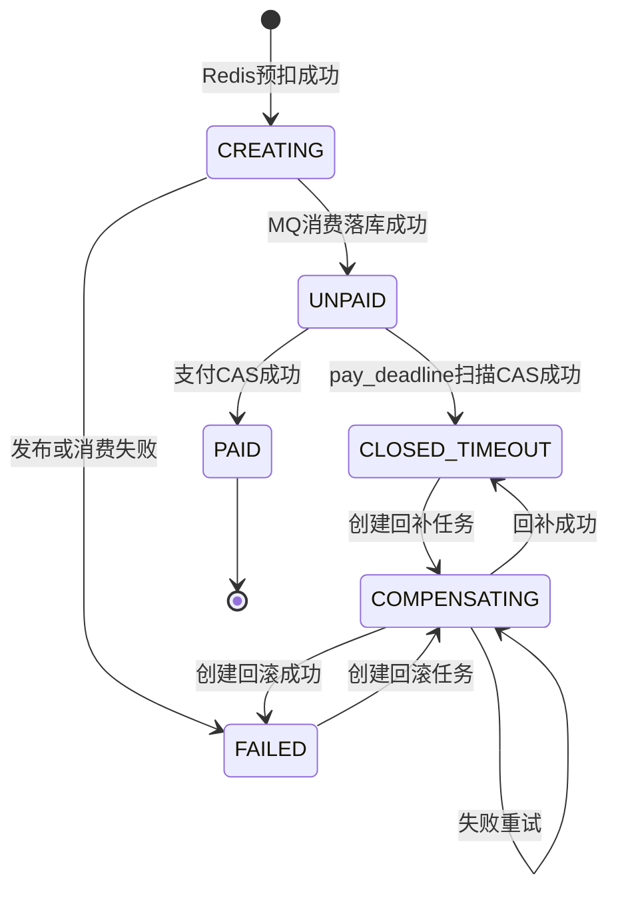

# ADR_DDL：秒杀系统数据库与一致性方案

- 状态：已采纳
- 日期：2026-10-11
- 范围：MySQL 8、Redis 7、RabbitMQ 的单场次秒杀链路

## 1. 背景

项目是 Java 17 + Spring Boot 3 的单体秒杀系统，单场次建模，一活动对应一商品；不做分库分表、微服务和后台管理。Redis 是秒杀库存权威源，MySQL 保存订单和事务兜底库存，RabbitMQ 用于订单落库削峰。

原方案存在以下风险：Redis 预扣后 MQ 发布失败可能导致库存永久少卖；Redis、MySQL 回补无法原子完成；TTL/DLX 超时链路复杂且难以验证；订单数量与库存对账口径不统一；补偿只能依赖订单状态 CAS，缺少可重试记录。

## 2. 决策

### 2.1 数据库与表结构

- 数据库名为 `seckill`，使用 `utf8mb4` 和 `utf8mb4_0900_ai_ci`。
- 所有业务表使用 InnoDB，并设置统一字符集、排序规则、表注释和字段注释。
- `updated_at` 使用 `DEFAULT CURRENT_TIMESTAMP ON UPDATE CURRENT_TIMESTAMP`。
- 保留四张核心表：`users`、`seckill_activity`、`orders`、`reconciliation_record`。
- 新增 `stock_compensation`，记录跨 Redis/MySQL 的库存回滚和回补任务。
- 保留外键约束，作为个人项目的数据完整性保护。

### 2.2 订单和限购

- `orders` 只保存 `UNPAID`、`PAID`、`CLOSED_TIMEOUT`。
- `CREATING`、`FAILED` 只存在 Redis，绝不落 MySQL。
- `COMPENSATING` 只表示补偿处理中的逻辑状态，记录在 `stock_compensation`，不写入 `orders`。
- `quantity` 固定为 1，并通过 `CHECK (quantity = 1)` 强制约束。
- 每人每活动只能一单，使用唯一索引 `uk_activity_user(activity_id, user_id)`。
- `close_reason` 只保留 `1=超时`，删除用户取消语义。
- 超时扫描使用 `idx_status_deadline(status, pay_deadline)`。

### 2.3 下单链路

1. API 完成鉴权、限流和幂等键校验。
2. Redis Lua 原子校验活动状态、用户限购和库存。
3. Lua 扣减库存、增加限购计数、写入 `order:state:{orderNo}=CREATING`，并把 orderNo 加入 `seckill:creating` ZSET。
4. 使用 RabbitMQ Publisher Confirm 发送订单消息。
5. 消费者使用订单号幂等落库，在同一 MySQL 事务中完成订单插入和 `available_stock >= 1` 条件扣减。
6. 消费成功后 Redis 状态推进为成功并从 CREATING 索引移除。
7. `CREATING` 超时、发布确认失败或消费失败时创建 `CREATE_ROLLBACK` 补偿任务，回滚 Redis 库存和限购计数，最终状态为 Redis 中的 `FAILED`。

RabbitMQ 只负责订单落库削峰，不使用 TTL、延迟队列、DLX 或 DLQ。

### 2.4 超时关闭

- 超时唯一主路径是定时扫描：

```sql
status = 'UNPAID' AND pay_deadline < CURRENT_TIMESTAMP
```

- 使用 CAS 更新：

```sql
UPDATE orders
SET status = 'CLOSED_TIMEOUT',
    close_time = CURRENT_TIMESTAMP,
    close_reason = 1
WHERE order_no = ?
  AND status = 'UNPAID';
```

- 只有影响行数为 1 时创建唯一的 `TIMEOUT_REFUND` 补偿任务。
- 建议每 30 秒或 1 分钟扫描一次，每批限制数量。

### 2.5 补偿与幂等

`stock_compensation` 使用：

- `compensation_type`：`CREATE_ROLLBACK`、`TIMEOUT_REFUND`
- `status`：`PENDING`、`COMPENSATING`、`SUCCESS`、`FAILED`
- 唯一键：`uk_compensation_order_type(order_no, compensation_type)`
- 重试字段：`retry_count`、`last_error`、`next_retry_at`

补偿任务必须按 orderNo 和补偿类型幂等。Redis、Redis 限购计数和 MySQL 库存任一步骤失败，都保留任务并重试，不直接丢弃，也不依赖重复执行订单关闭来补偿。

### 2.6 Redis 故障策略

Redis 不可用时秒杀接口 fail-close：返回系统繁忙，不降级到 MySQL 库存继续下单。Redis 恢复后从 MySQL 初始化库存，并完成 Redis/MySQL/订单对账后再开放活动。

不再维护 `seckill:sold` 集合，限购只使用 `seckill:bought:{activityId}` Hash。

### 2.7 对账口径

库存统一按售出件数对账，不按订单条数对账：

```text
sold_quantity = SUM(quantity) WHERE status IN (UNPAID, PAID)
redis_diff = total_stock - redis_stock - sold_quantity
mysql_diff = total_stock - mysql_available_stock - sold_quantity
```

只有 `redis_diff = 0` 且 `mysql_diff = 0` 才视为一致。对账只记录和告警，不自动修改线上库存或订单。Redis 快照由任务读取后写入 `reconciliation_record`。

## 3. 状态机



其中 `CREATING`、`FAILED` 是 Redis 状态；`COMPENSATING` 是补偿任务状态，不是 MySQL 订单状态。

## 4. 后果

### 正面

- Redis 预扣、MQ 削峰、MySQL 条件扣减和补偿任务职责清晰。
- MQ 发布失败、消费失败、Redis/MySQL 回补失败都有可恢复路径。
- 删除 TTL/DLX 后，超时逻辑只有一条数据库扫描链路，更适合 3 周项目。
- `quantity=1` 消除订单数和库存件数的口径歧义。
- 对账可以分别发现 Redis 差异和 MySQL 差异。

### 代价

- 增加 `stock_compensation` 表和补偿任务实现成本。
- Redis 与 MySQL 仍是最终一致，不提供跨系统强一致事务。
- 超时关闭最多延迟一个扫描周期。
- Redis 故障时系统主动拒绝下单，牺牲可用性换取库存安全。
- Publisher Confirm、重试、补偿和对账需要日志与指标支持。

## 5. 验证要求

- 重复插入同用户同活动必须命中 `uk_activity_user`。
- 超时扫描 `EXPLAIN` 应优先使用 `idx_status_deadline`，预期 `type=range`。
- `available_stock=1` 的条件扣减影响 1 行，`available_stock=0` 影响 0 行。
- 不存在的用户或活动必须被外键拒绝。
- `quantity=2` 必须被 `ck_order_quantity` 拒绝。
- `CREATING/FAILED` 不得出现在 `orders`。
- 测试脚本为 `docs/test_v2.sql`；执行预期失败用例时使用 MySQL 客户端 `--force`。

## ADR-016 Publisher Confirm 不确定窗口与消费侧状态防线

- **状态**：已采纳
- **日期**：2026-10-17
- **范围**：v2 Redis 预扣、RabbitMQ 异步落库和订单查询

### 背景

Publisher Confirm 存在极小的不确定窗口：消息可能已经被 Broker 投递或消费者处理，但发布端因网络异常收到失败或超时确认。若只依赖发布端回滚，可能出现重复消费或 Redis 回滚与 MySQL 已落库并存的短暂风险。

### 决策

1. Consumer 处理前读取 `order:state:{orderNo}`：
  - `CREATING`：继续处理；
  - `FAILED`：直接 ACK，丢弃已由发布端回滚的消息；
  - `UNPAID`：直接 ACK，丢弃已处理消息；
  - Key 不存在：直接 ACK，丢弃过期或非法消息。
2. `seckill_full.lua` 原子写入 `order:owner:{orderNo} = userId`，TTL 与订单状态相同。`CREATING/FAILED` 查询必须校验 owner，不允许仅凭 orderNo 读取他人状态。
3. Consumer 的数据库失败重试采用应用层固定退避 `100ms -> 500ms -> 1s`，不引入延迟队列；三次失败后回滚 Redis、写 `FAILED`，并使用 `basicNack(requeue=false)` 进入 DLX。
4. Confirm 不确定窗口作为已知限制记录到 v2 复盘，由 v4 对账发现 Redis、MySQL 和订单聚合差异。

### 后果

- 大部分重复投递和晚到消息在 Consumer 入口被状态拦截。
- `order:owner` 增加一个短 TTL Redis Key 和一次 Lua 写入，但修复了 CREATING/FAILED 查询越权。
- 应用层退避会短暂占用 Consumer 线程，但实现简单，且避免引入延迟队列。
- Confirm 不确定窗口不能被 v2 完全消除，必须依靠 v4 对账暴露残余差异。

## ADR-010 MQ 发布失败与 CREATING 补偿

- **状态**：已采纳
- **日期**：2026-10-18
- **范围**：v2 Redis 预扣、MQ 异步落库和 CREATING 超时处理

### 背景

Redis Lua 预扣成功后，订单会进入 `CREATING` 并写入 `seckill:creating` ZSET。MQ 发布确认失败、消费者处理失败或应用异常退出，都可能使订单长期停留在 `CREATING`，造成 Redis 库存和用户限购标记被占用。

### 决策

1. `CreatingCompensationJob` 每 30 秒执行一次：
  `ZRANGEBYSCORE seckill:creating 0 now LIMIT 0 100`。
2. 逐条读取 `order:state:{orderNo}`：
  - `CREATING`：执行 `rollback.lua`；
  - 其他状态或 Key 不存在：只删除 ZSET 成员，不改库存。
3. `rollback.lua` 首先检查 state 是否为 `CREATING`。只有检查通过时，才执行库存 `INCR`、删除用户标记、写 `FAILED` 和 `ZREM`；因此重复执行不会重复回滚库存。
4. Redis 异常、Key 缺失或脚本失败时保留 ZSET 成员，下一轮继续重试；按订单记录失败次数，超过 3 次输出告警日志并增加告警计数器。
5. MQ Publisher Confirm 失败和 CREATING 超时共用同一回滚语义。v2 不使用延迟队列；RabbitMQ DLX 只承接消费者重试耗尽后的消息，不负责触发补偿。

### 关键 Key

| Key | 用途 | TTL |
|---|---|---|
| `seckill:creating` | `orderNo -> expireAt` 补偿索引 | 随成员收敛删除 |
| `order:state:{orderNo}` | 判断是否仍可回滚 | 300 秒 |
| `order:owner:{orderNo}` | 构造用户限购 Key | 300 秒 |
| `order:activity:{orderNo}` | 构造库存 Key | 300 秒 |
| `order:compensation:attempts:{orderNo}` | 失败次数和超 3 次告警 | 24 小时 |

### 后果

- 发布失败和 CREATING 超时最终共享一致的 Redis 回滚逻辑，降低重复实现和幂等风险。
- 补偿任务最多每批处理 100 条，单轮处理能力有限，积压需要通过日志和指标观测。
- 补偿失败不会从 ZSET 删除，Redis 故障恢复后可以继续收敛。
- 超过 3 次只告警，不在 v2 自动改 MySQL；残余 Redis/MySQL 差异由 v4 对账发现。
