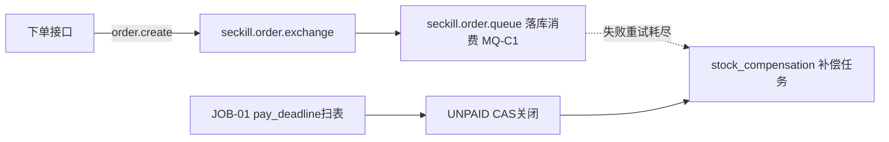
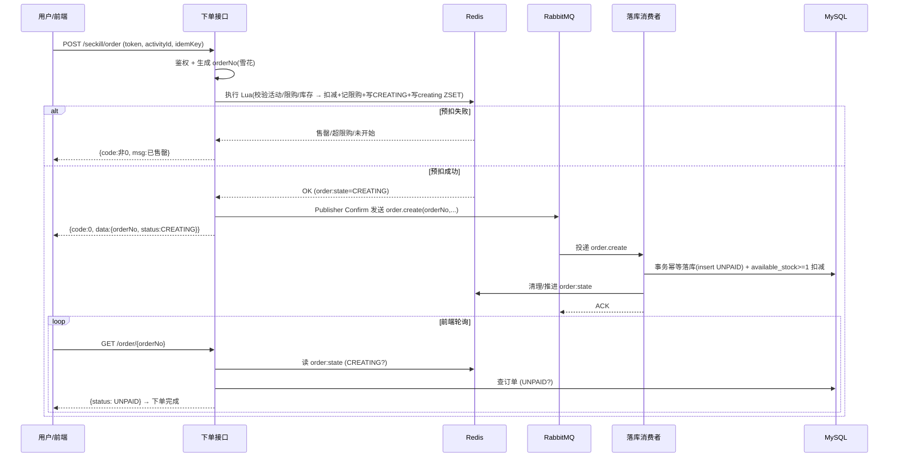
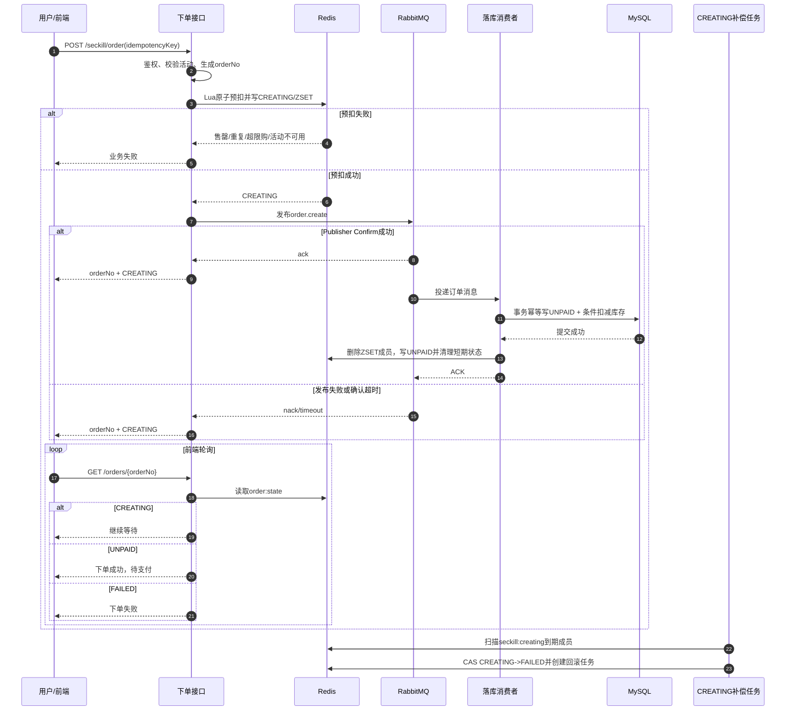
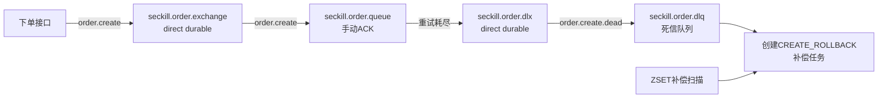
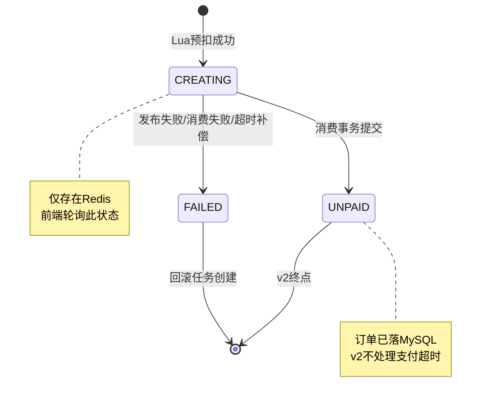
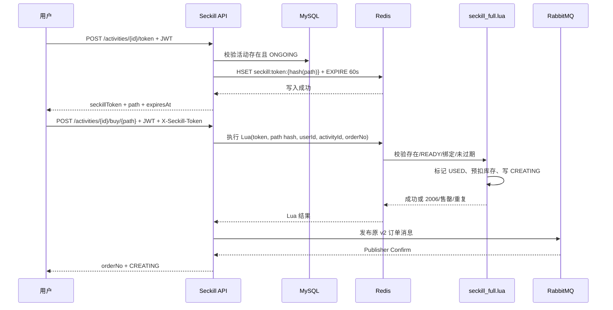

# 秒杀系统设计文档

> 版本：v1.0 ｜ 状态：设计定稿（实现前基线）
> 说明：本文档只做设计，不含业务代码与 DDL。表结构以「字段清单」形式描述，不落 SQL。

---

## 1. 项目背景与约束

**目标**：面向秋招的个人项目，完整演示高并发秒杀链路的核心能力——防超卖、削峰填谷、最终一致、异常补偿；不追求商城完整度。

| 维度 | 约束 |
|---|---|
| 人力 / 周期 | 1 人 / 3~4 周 |
| 技术栈 | Java 17 + Spring Boot 3 + MySQL 8 + Redis 7 + RabbitMQ |
| 架构形态 | 单体应用；**不做**微服务 / K8s / 分库分表 |
| 链路范围 | 只做秒杀链路，不做完整商城 |

**功能范围**

| 做 | 不做 |
|---|---|
| 登录、商品列表、秒杀下单、订单查询、模拟支付、超时取消、库存回补、对账 | 购物车、后台管理、真实支付、推荐、搜索 |

---

## 2. 角色 × 场景矩阵

| 角色 | 开抢前 | 开抢瞬间 | 下单后 | 故障时 |
|---|---|---|---|---|
| **普通用户** | 注册/登录；浏览秒杀列表与详情；看倒计时等待；刷新/轮询活动状态 | 点「立即抢购」提交下单；等待结果（排队中/成功/售罄/被限流）；失败重试 | 查订单状态；模拟支付；未支付等超时取消；看订单详情 | 看到「系统繁忙/稍后再试」降级提示；请求被限流；重试或放弃 |
| **黄牛/脚本**（防御对象） | 探测接口与参数；囤积账号/令牌；预热脚本、伪造设备 | 绕过前端直调 API；高频并发刷单；重放请求；多账号抢同一商品 | 恶意占库存不支付；批量下单后取消；薅限购羊毛转卖 | 趁降级/重试混乱放大攻击；用重试风暴打垮系统 |
| **运营**（不做后台） | 设定商品/库存/起止时间/限购规则——用**初始化数据+配置**代替后台 | 关注销量/库存/成功率大盘——用**日志+监控指标**观测 | 查看成交与异常订单、处理客诉——仅**数据查询** | 决定暂停/回滚活动、发公告——靠**活动开关配置/停服** |
| **DBA**（不做工具） | 表结构与索引设计；评估写入压力；规划库存扣减与对账方案 | 关注慢查询、连接数、行锁等待、主从延迟 | 保证订单/库存一致性；冷热数据；对账核销 | 排查死锁、主从切换、数据恢复 |
| **运维**（不做 K8s/微服务） | 部署、压测、容量规划；配置限流阈值与降级预案；预热缓存 | 监控 QPS/RT/错误率及 Redis/MySQL/MQ 指标；触发限流/熔断/降级 | 监控 MQ 积压与异步任务健康度 | 应急处置、重启/切流、看日志监控定位、恢复 |

---

## 3. 核心用例列表

> `角色=系统` 表示由**定时器 / MQ 消费 / 下单主流程**自动触发的后端用例，其价值服务于运营、DBA、运维的关切，但**不做管理界面/工具**，全部内化在秒杀链路里。

| 用例编号 | 角色 | 场景 | 动作 | 结果 |
|---|---|---|---|---|
| UC-01 | 普通用户 | 开抢前 | 注册/登录，获取访问令牌（JWT） | 登录成功，后续请求凭令牌鉴权 |
| UC-02 | 普通用户 | 开抢前 | 查看秒杀商品列表 | 返回商品、剩余库存、状态（未开始/进行中/已结束）、开抢倒计时 |
| UC-03 | 普通用户 | 开抢前 | 查看秒杀商品详情 | 返回价格、每人限购数、库存、活动规则 |
| UC-04 | 普通用户 | 开抢瞬间 | 提交秒杀下单请求（令牌 + 商品ID + 幂等号） | 通过前置校验后进入下单流程，返回受理凭证（orderNo + CREATING） |
| UC-05 | 系统 | 开抢瞬间 | 前置校验：登录 token 鉴权 + 幂等号去重 + 用户级限购（每人 N 件）；限流可选 | 未登录/重复提交/超限购被拒，不进入扣减 |
| UC-06 | 系统 | 开抢瞬间 | Redis + Lua 脚本**原子预扣库存**（含活动状态、限购、库存校验） | 库存足→预扣成功；库存不足/超限购→返回「已售罄」，不产生订单 |
| UC-07 | 系统 | 开抢瞬间 | 同步生成 orderNo + 写 Redis CREATING + Publisher Confirm 发 MQ；消费端按 orderNo **幂等落库** + MySQL `available_stock>=1` 条件扣减 | 落库成功→UNPAID；发布/消费失败→创建补偿任务并回滚 Redis 预扣→FAILED |
| UC-08 | 普通用户 | 开抢瞬间 | 轮询 `/order/{orderNo}`（Redis-first，不碰 DB） | status≠CREATING 即完成：UNPAID=下单成功待支付、FAILED=下单失败 |
| UC-09 | 普通用户 | 下单后 | 查询订单列表/详情及状态 | 返回状态：待支付/已支付/超时关闭 |
| UC-10 | 普通用户 | 下单后 | 对「待支付」订单模拟支付 | 订单 UNPAID→PAID，确认库存扣减；非待支付态按状态 CAS 幂等拒绝 |
| UC-11 | 系统 | 下单后 | 支付超时检测：定时扫描 `pay_deadline`，统一 15 分钟 | 超时未支付→关闭订单，UNPAID→CLOSED_TIMEOUT |
| UC-12 | 系统 | 下单后 | 关闭订单创建**库存补偿任务** | Redis 库存、限购额度和 MySQL 库存由补偿任务幂等回补 |
| UC-13 | 系统（代运营/DBA） | 故障时 | 定时**对账**：Redis 库存 vs MySQL（订单 + 库存） | 检出超卖/少卖差异，**只记录 + 告警，不自动改线上数据** |
| UC-14 | 系统 | 故障时 | 发布/消费失败 → 创建 `CREATE_ROLLBACK` 补偿任务 | 补偿任务按 orderNo 幂等回滚 Redis 预扣并告警 |

---

## 4. 仅作为设计约束、不做功能的角色

- **黄牛/脚本**：纯防御对象，**绝不为它做功能**；对其防护（token 鉴权、幂等、限购、原子扣减）内化到普通用户链路（UC-05/06）。
- **运营**：**不做后台管理**。活动配置用种子数据/配置文件，大盘用日志+监控，暂停用活动开关配置。唯一被功能化的是轻量对账（UC-13）。
- **DBA**：**不做 DBA 工具**。其关切内化为技术选型：Redis 预扣 + DB 兜底防超卖、对账、订单/库存表设计。
- **运维**：**不做完整运维/监控体系**（无 K8s、无微服务）。接口限流、降级提示、超时取消属于要实现的链路功能，其余靠中间件自带指标 + 日志。

> **结论**：真正「做功能」的角色只有 `普通用户`（前台）+ `系统`（自动化链路）；黄牛、运营、DBA、运维均为设计约束。

---

## 5. 关键架构决策（ADR）

### ADR-1 下单：Redis 预扣 + MQ 异步落库 + 前端轮询
- **决策**：下单接口在 Redis 用 Lua 原子预扣成功后，**同步生成 orderNo**，写入 `CREATING` 和待补偿 ZSET，再使用 RabbitMQ Publisher Confirm 发送订单消息；前端轮询 `/order/{orderNo}` 直到状态不再是 CREATING。
- **关键约束**：`CREATING` 和 `FAILED` 只存在 Redis，**不落 MySQL**；发布确认失败或超时由补偿任务处理。下单完成的终态是 **UNPAID**（PAID 只在支付后出现）。
- **权衡**：引入结果查询、消费幂等、失败一致性成本；下单完成的终态是 **UNPAID**（PAID 只在支付后出现），轮询判定应为「status ≠ CREATING」。

### ADR-2 防刷：token + 幂等 + 限购「三件套」
- **决策**：登录 token 鉴权 + 幂等号去重 + 用户级限购（固定每人每活动一单）为必做；验证码不做；下单接口增加轻量限流。
- **理由**：单人 3~4 周下以最小成本挡住重复提交和基础脚本流量。
- **被否方案**：验证码/答题、隐藏秒杀 URL列为可选加分项，不阻塞主链路。

### ADR-3 库存一致性：Redis 预扣 + MySQL 兜底 + 对账只告警
- **决策**：**Redis 预扣为库存权威源**；MySQL 落库时用 `available_stock >= 1` 条件扣减做**二次防超卖兜底**；对账任务只检测差异 + 告警；所有跨 Redis/MySQL 的回滚和回补进入 `stock_compensation`，按订单和补偿类型幂等重试。
- **理由**：单一权威源避免双写竞争；对账只告警降低自动改数据引入新不一致的风险。
- **权衡**：Redis 与 MySQL 可能短暂不一致，靠补偿任务收敛、靠对账暴露；Redis 不可用时秒杀直接 fail-close，不降级到 MySQL 库存。

### ADR-4 超时取消：定时扫描为唯一主路径
- **决策**：不使用 RabbitMQ TTL/DLX 处理超时；定时任务按 `status = UNPAID AND pay_deadline < now()` 扫描订单，执行 `UNPAID -> CLOSED_TIMEOUT` CAS。CAS 成功后只创建一个 `TIMEOUT_REFUND` 补偿任务。
- **理由**：支付截止时间是订单字段，数据库扫描路径确定、可重跑、易验证，避免维护两套超时触发链路。
- **权衡**：关闭可能有最多一个扫描周期的延迟；通过 `idx_status_deadline` 和每批限量控制数据库压力。

### ADR-5 幂等：状态 CAS + 补偿唯一键
- **决策**：消费落库和支付/关闭使用订单状态 CAS；跨 Redis/MySQL 的库存动作使用 `stock_compensation(order_no, compensation_type)` 唯一键幂等。补偿处理中状态为 `COMPENSATING`，记录在补偿表，**不写入 orders**。


---

stateDiagram-v2
    [*] --> CREATING: Redis预扣成功
    CREATING --> UNPAID: 消费落库成功
    CREATING --> FAILED: 发布/消费失败
    FAILED --> COMPENSATING: 创建回滚任务
    UNPAID --> PAID: 模拟支付成功
    UNPAID --> CLOSED_TIMEOUT: pay_deadline到期扫描
    CLOSED_TIMEOUT --> COMPENSATING: 创建回补任务
    COMPENSATING --> CLOSED_TIMEOUT: 回补成功
    COMPENSATING --> FAILED: 创建回滚成功
    COMPENSATING --> COMPENSATING: 失败重试
    PAID --> [*]
    FAILED --> [*]
    CLOSED_TIMEOUT --> [*]
```

| 状态 | 含义 | 存储位置 | 触发 |
|---|---|---|---|
| CREATING | 预扣成功、MQ 已确认、DB 未落库 | **Redis**（`order:state:{orderNo}`，短 TTL） | 下单接口 |
| UNPAID | 已落库、待支付 | **MySQL** | 落库消费者 |
| PAID | 已支付（终态） | MySQL | 支付接口 |
| CLOSED_TIMEOUT | 超时关闭，等待库存回补 | MySQL | 定时扫描 CAS |
| COMPENSATING | Redis/MySQL 库存补偿处理中 | `stock_compensation` | 补偿任务 |
| FAILED | 下单失败，等待回滚 Redis 预扣 | **Redis** | 发布/消费失败补偿 |

> 关键点：**CREATING / FAILED 是 DB 落库前的 Redis 侧状态，绝不落 MySQL**；`COMPENSATING` 只记录在 `stock_compensation`，不写入 `orders`。UNPAID 之后以 MySQL 为准。轮询接口需 Redis-first 合并读取。

---

## 7. 领域模型

> 概念字段清单，非 DDL。

**User（用户）**

| 字段 | 说明 |
|---|---|
| id | 主键 |
| username | 登录名，唯一 |
| password | 加密存储（如 BCrypt） |
| created_at | 创建时间 |

**SeckillActivity（秒杀活动/商品）**

| 字段 | 说明 |
|---|---|
| id | 主键 |
| goods_name / goods_img | 商品名称、图片 |
| original_price / seckill_price | 原价、秒杀价 |
| total_stock | 总库存（初始化时同步到 Redis） |
| available_stock | MySQL 剩余库存；落库时**同一事务内** `available_stock>=1` 条件扣减防超卖（兜底，先同步扣，压测后再优化；不引入 version 乐观锁） |
| limit_per_user | 每人限购数 |
| start_time / end_time | 活动起止时间 |
| status | 未开始 / 进行中 / 已结束 / 已暂停（活动开关） |

> 单场次秒杀，活动与商品**合并建模、不拆表**（一活动 = 一商品）。

**Order（订单）**

| 字段 | 说明 |
|---|---|
| id | 主键 |
| order_no | 业务订单号，**唯一**，varchar(32) 带业务前缀（如 `SK+yyyyMMdd+雪花序列`），下单接口生成 |
| user_id / activity_id | 归属用户、活动 |
| goods_name / seckill_price | 下单时商品名称、成交单价快照（防活动改名改价） |
| quantity / amount | 数量固定为 1、应付金额（amount = seckill_price × quantity） |
| status | UNPAID / PAID / CLOSED_TIMEOUT（DB 侧枚举） |
| create_time / pay_deadline | 下单时间、支付截止（= create_time + 15min，扫表与展示用） |
| pay_time / close_time / close_reason | 支付时间、关闭时间、关闭原因 |

**ReconciliationRecord（对账记录，可选）**

| 字段 | 说明 |
|---|---|
| id / activity_id | 主键、活动 |
| redis_stock / mysql_available_stock / sold_quantity | 对账时三方库存和有效售出件数快照 |
| redis_diff / mysql_diff / result | Redis 差异、MySQL 差异、结论（一致 / 超卖 / 少卖） |
| created_at | 对账时间 |

**关系**：User 1—N Order；SeckillActivity 1—N Order；库存权威在 Redis（`seckill:stock`），MySQL `seckill_activity.available_stock` 与订单聚合用于对账。

---

## 8. 接口清单

**统一响应结构**：`{ code, message, data, traceId }`，`code=0` 成功，非 0 为业务/系统错误。所有需鉴权接口从 `Authorization: Bearer <accessToken>` 携带 JWT。完整字段、校验和错误码见 `docs/REST_API.md`。

| 编号 | 方法 | 路径 | 说明 | 关键入参 | 关键出参 | 校验 / 幂等 | 用例 |
|---|---|---|---|---|---|---|---|
| API-01 | POST | `/api/auth/login` | 登录 | username, password | token(JWT) | 凭证校验 | UC-01 |
| API-02 | GET | `/api/seckill/activities` | 秒杀商品列表 | — | [{activityId, goodsName, seckillPrice, displayStock, status}] | 读缓存/Redis | UC-02 |
| API-03 | GET | `/api/seckill/activities/{activityId}` | 商品详情 | activityId | 详情 + 限购 + 库存 | 活动存在性 | UC-03 |
| API-04 | POST | `/api/seckill/activities/{activityId}/token` | 获取秒杀 token/path | Header: JWT；activityId | {seckillToken, path, expiresAt} | 活动状态校验 | UC-04 |
| API-05 | POST | `/api/seckill/activities/{activityId}/buy/{path}` | 秒杀下单 | Header: JWT/token/idempotency-key | {orderNo, status: CREATING} | 鉴权 + 幂等 + 限购 + Lua 原子预扣 | UC-04/05/06/07 |
| API-06 | GET | `/api/orders/{orderNo}` | 轮询下单结果 / 订单详情 | Header: JWT | {orderNo, status, ...} | Redis-first；订单归属校验 | UC-08/09 |
| API-07 | POST | `/api/orders/{orderNo}/pay` | 模拟支付 | Header: JWT | {status: PAID} | 仅 UNPAID 可支付；状态 CAS 幂等 | UC-10 |

**非 HTTP 组件（后台自动化）**

| 编号 | 类型 | 职责 | 用例 |
|---|---|---|---|
| MQ-C1 | 消费者 | 落库消费：幂等写订单 UNPAID + `stock>=1` 扣减 | UC-07 |
| JOB-01 | 定时任务 | 扫描 `pay_deadline`：关闭超时 UNPAID 订单并创建回补任务 | UC-11/12 |
| JOB-02 | 定时任务 | 扫描 `stock_compensation`：执行 Redis/MySQL 补偿并重试 | UC-14 |
| JOB-03 | 定时任务 | 对账：读取 Redis + MySQL 售出件数，记录双差异并告警 | UC-13 |

---

## 9. Redis Key 与数据结构设计

| Key | 类型 | 内容 | TTL | 用途 |
|---|---|---|---|---|
| `seckill:activity:{activityId}` | Hash | 活动元信息（名称/价格/起止/限购/状态开关） | 活动期 | 列表、详情、下单前置校验 |
| `seckill:stock:{activityId}` | String(int) | 剩余可抢库存（**权威源**） | 活动期 | Lua 原子扣减 / 回补 |
| `seckill:token:{hash(path)}` | Hash/String | 用户和活动绑定的一次性秒杀凭证、path 状态和过期时间 | 短 TTL（建议 60 秒） | API-04 生成，API-05 原子校验并消费 |
| `seckill:bought:{activityId}` | Hash（userId→已购数） | 用户级限购计数 | 活动期 | 限购校验 + 回退 |
| `seckill:idem:{userId}:{activityId}:{idempotentKey}` | String | 幂等标记 | 短（如 5min） | 防重复/重放下单 |
| `order:state:{orderNo}` | String/Hash | 落库前订单状态（CREATING / FAILED） | 短（如 30min） | 轮询读取（DB 落库前） |
| `seckill:creating` | ZSET（orderNo→expireAt） | CREATING 订单补偿索引 | 短期 | 扫描发布失败或消费超时的订单 |

**下单预扣 Lua 脚本职责（原子执行，任一失败则整体不生效）**：
1. 校验活动存在且处于「进行中」；
2. 校验用户限购（`bought` 计数 < `limit_per_user`）；
3. 校验库存 > 0；
4. 扣减库存（`stock` decr）；
5. 限购计数 +1（`bought`）；
6. 写幂等标记 + `order:state:{orderNo} = CREATING`，并将 orderNo 写入 `seckill:creating` ZSET；CREATING/FAILED 只存在 Redis，不落 MySQL。

> orderNo 由下单接口在调用 Lua 前生成（varchar(32)，业务前缀 + 雪花序列，如 `SK+yyyyMMdd+雪花`）并作为参数传入。

---

## 10. MQ 拓扑



| 组件 | 名称 | 关键配置 | 说明 |
|---|---|---|---|
| 落库交换机 | `seckill.order.exchange` | durable direct，Publisher Confirm | 下单主链路 |
| 落库队列 | `seckill.order.queue` | durable、手动 ACK、失败重试 N 次 | 超过重试次数后创建 `CREATE_ROLLBACK` 补偿任务并 ACK |
| 超时扫描任务 | `JOB-01` | 每 30 秒或 1 分钟，每批限量 | 按 `status=UNPAID AND pay_deadline < now()` 扫描 |
| 补偿任务 | `JOB-02` | 扫描 `PENDING/FAILED` 且到重试时间的记录 | 执行 Redis/MySQL 回滚或回补，状态为 `COMPENSATING` |

> 不使用 RabbitMQ TTL/DLX；RabbitMQ 只负责订单落库削峰，超时关闭和失败恢复由数据库扫描、Redis ZSET 和补偿任务主导。

---

## 11. 关键时序

### 11.1 秒杀下单



### 11.2 模拟支付
1. 用户 `POST /order/{orderNo}/pay`（携带 token）。
2. 校验订单归属当前用户。
3. **状态 CAS**：`UPDATE order SET status=PAID, pay_time=now WHERE order_no=? AND status=UNPAID`。
4. 影响行数 = 1 → 支付成功返回 `{status:PAID}`；= 0 → 说明已支付/已关闭，按幂等返回当前状态，不重复扣减。

### 11.3 超时取消（定时扫描主路径）
- JOB-01 每 30 秒或 1 分钟按 `status=UNPAID AND pay_deadline < now()` 扫描，每批限量处理。
- 若为 UNPAID，执行 **状态 CAS**：`UPDATE ... SET status=CLOSED_TIMEOUT, close_time=now(), close_reason=1 WHERE order_no=? AND status=UNPAID`。
- 影响行数为 1 时，插入唯一的 `TIMEOUT_REFUND` 补偿任务；补偿状态为 `COMPENSATING`，不写入 orders。
- 补偿任务按 Redis 库存、Redis 限购、MySQL 库存顺序执行，失败可重试；`uk_compensation_order_type` 保证只创建一次。

### 11.4 对账（JOB-02，只告警）
1. 取活动：`redis_stock = GET seckill:stock:{id}`；MySQL 查询 `sold_quantity = SUM(quantity)`（UNPAID+PAID）和 `mysql_available_stock`。
2. 分别校验：`redis_diff = total_stock - redis_stock - sold_quantity`；`mysql_diff = total_stock - mysql_available_stock - sold_quantity`。
3. 两个差异都为 0 才算一致；否则写入 `ReconciliationRecord` 并告警，**不自动修改线上库存/订单**。
4. `redis_diff < 0` 或 `mysql_diff < 0` 为疑似超卖；正数为疑似少卖、漏扣或回补异常。

---

## 12. 幂等与一致性要点

- **消费落库幂等**：`order_no` 唯一键；落库前先查/依赖唯一约束；仅 CREATING→UNPAID 流转成功才算落库。
- **回补幂等**：只有 UNPAID→CLOSED_TIMEOUT 的 CAS 成功分支创建 `TIMEOUT_REFUND`；补偿表唯一键保证只执行一份任务。
- **回滚幂等**：发布/消费失败创建 `CREATE_ROLLBACK`；以 `order_no + compensation_type` 唯一键和 Redis 状态保证只回滚一次。
- **限购联动**：FAILED / CLOSED_TIMEOUT 的补偿任务回退 `seckill:bought`，避免用户额度被误锁。
- **防超卖三道防线**：① Redis Lua 原子扣减 → ② MySQL `available_stock>=1` 条件扣减 → ③ Redis/MySQL 双口径对账告警。

---

## 13. 非功能设计（设计约束角色的落地）

- **限流（可选）**：接口层令牌桶/滑动窗口，重点保护下单与轮询；开抢瞬间轮询是读热点。
- **降级**：活动开关（暂停）、售罄快速失败、商品列表静态化/缓存化。
- **可观测**：关键节点结构化日志（预扣结果、落库、关闭、回补、对账差异）、MQ 积压监控、库存指标。
- **DBA 关切落地**：订单表 `order_no` 唯一索引、`(user_id, create_time)` 查询索引、`(status, pay_deadline)` 供扫表；库存扣减走条件更新避免悲观锁。

---

## 14. 未决 / 可选加分项

| 项 | 状态 | 说明 |
|---|---|---|
| 接口限流是否落地 | 可选 | 用户定为可选，建议至少给下单/轮询加轻量限流 |
| 隐藏/动态秒杀 URL | 可选加分 | 防脚本提前直调，增加令牌管理成本 |
| 压测与容量数据 | 建议做 | 秋招展示用，可用 JMeter 出一份 QPS/RT 报告 |
| Redis 故障策略 | 已确定 | Redis 不可用时秒杀 fail-close；恢复后从 MySQL 初始化并重新对账 |
| 超时链路 | 已确定 | 不使用 TTL/DLX，统一由 `pay_deadline` 扫描关闭 |

---

## 15. v2 设计

### 15.1 目标（量化）

v2 以 v1 的同步下单结果作为同环境对照基线：QPS **152.6**、P99 **1304 ms**。在保持同一台机器、同一数据库连接池配置、同一压测脚本和同一库存规模的前提下，目标如下：

| 指标 | v1 基线 | v2 目标 | 验收口径 |
|---|---:|---:|---|
| 下单受理吞吐 | 152.6 QPS | ≥ 300 QPS | 预热 2 轮后正式 3 轮取中位数 |
| 下单接口 P99 | 1304 ms | ≤ 500 ms | 仅统计 HTTP 受理接口，不把异步落库时间计入 |
| 下单接口成功率 | 以压测结果为准 | ≥ 99%（Redis/MQ 正常） | 排除业务售罄、重复下单和非法请求 |
| 库存正确性 | 无超卖 | 无超卖、无少卖 | 压测结束后 Redis、MySQL 和订单聚合三方对账差异为 0 |
| 异步收敛 | 不适用 | 99% 订单 ≤ 5 秒进入 UNPAID/FAILED | 从 API 返回 CREATING 开始计时，MQ/DB 正常时统计 |

> v2 的性能目标衡量“快速受理”而非“同步完成订单”。消息积压、数据库不可用或 Redis 故障时不以牺牲库存正确性换取可用性。

### 15.2 范围

**本版本实现：**

- Redis Lua 原子预扣：一次脚本完成活动校验、限购校验、库存扣减、限购计数、幂等标记、`CREATING` 状态和补偿 ZSET 写入。
- RabbitMQ 异步落库：下单接口只负责受理并发布订单消息，消费者事务内幂等写入 `UNPAID` 订单并执行 MySQL 条件扣减。
- `CREATING -> UNPAID` 轮询：前端按 `orderNo` 查询，Redis 仍为 `CREATING` 时继续轮询，进入 `UNPAID` 或 `FAILED` 后结束。
- Publisher Confirm：只有 Broker 确认发布成功后，消息发布才视为成功；发布失败或确认超时进入补偿路径。
- `CREATING` 超时补偿：定时扫描 `seckill:creating` ZSET，将超过阈值仍未收敛的订单标记为 `FAILED`，创建 `CREATE_ROLLBACK` 任务，回滚 Redis 预扣和限购计数。
- 消费失败重试与死信：仅处理消息本身无法消费的异常；重试耗尽后进入死信队列并创建补偿任务。

**本版本不实现：**

- 秒杀 token + 动态 path，列入 v3。
- 限流，列入 v3；v2 只保留 Redis 故障时 fail-close 和基础参数校验。
- 超时取消及 `UNPAID -> CLOSED_TIMEOUT`，列入 v4；v2 不扫描 `pay_deadline`，也不做支付超时库存回补。
- 对账任务，列入 v4；v2 只提供验收脚本/人工核对口径，不做定时对账和自动告警。

### 15.3 核心链路时序图



### 15.4 Redis Key 表

| Key | 类型 | 用途 | TTL |
|---|---|---|---|
| `seckill:activity:{activityId}` | Hash | 活动状态、时间、限购和商品快照 | 活动结束后 24 小时 |
| `seckill:stock:{activityId}` | String(int) | Redis 库存权威值，Lua 扣减/补偿 | 活动结束后 24 小时 |
| `seckill:bought:{activityId}` | Hash | `userId -> 已预扣数量`，Lua 限购校验 | 活动结束后 24 小时 |
| `seckill:idem:{userId}:{activityId}:{idempotencyKey}` | String | 幂等请求与 `orderNo` 的映射 | 30 分钟 |
| `order:state:{orderNo}` | String | `CREATING`、`UNPAID` 或 `FAILED` | 30 分钟；订单落库后可提前清理 |
| `order:detail:{orderNo}` | Hash | 订单消息所需的用户、活动、价格等快照 | 30 分钟 |
| `seckill:creating` | ZSET | `orderNo -> expireAt`，扫描未收敛订单 | 30 分钟；成员成功收敛后删除 |
| `seckill:rollback:{orderNo}` | String | 回滚任务幂等标记，避免重复恢复库存/限购 | 24 小时 |

> TTL 是兜底清理时间，不承担业务超时触发职责。任何 Redis 写入都不能覆盖仍在有效期内的幂等结果；Lua 脚本负责保证同一请求的写入原子性。

### 15.5 MQ 拓扑



| 组件 | 名称 | 关键配置 | 职责 |
|---|---|---|---|
| 业务交换机 | `seckill.order.exchange` | durable、direct、Publisher Confirm | 接收 `order.create` |
| 落库队列 | `seckill.order.queue` | durable、手动 ACK、固定次数重试 | 交给消费者事务落库 |
| 死信交换机 | `seckill.order.dlx` | durable、direct | 接收重试耗尽或拒绝的消息 |
| 死信队列 | `seckill.order.dlq` | durable、告警 | 保留原始消息并触发回滚补偿 |

> DLX 只用于消息异常和重试耗尽，不用于支付超时；v2 的 `CREATING` 超时由 Redis ZSET 扫描负责。消费者只有在数据库事务提交后 ACK，重复投递依靠订单唯一键和状态 CAS 消除影响。
>
> 说明：前文第 10 节描述的是 v1/既有方案，其中“不使用 TTL/DLX”保持不变；本节的 DLX 是 v2 为承接消息重试耗尽新增的拓扑，不承担支付超时处理。

### 15.6 幂等设计

| 场景 | 幂等依据 | 重复执行结果 |
|---|---|---|
| 重复 HTTP 下单 | `userId + activityId + idempotencyKey` 对应 Redis 幂等键 | 返回首次 `orderNo`，不再次扣库存 |
| Redis 预扣 | Lua 内原子检查幂等键、限购和库存 | 脚本失败整体回滚，不留下半成品 |
| 消费落库 | `orders.uk_order_no` + 事务内状态判断 | 已落库消息直接 ACK，不重复扣 MySQL 库存 |
| MySQL 库存扣减 | `available_stock >= 1` 条件更新 | 影响行数为 0 则落库事务失败，进入回滚补偿 |
| 发布失败/消费失败 | `orderNo + CREATE_ROLLBACK` 唯一语义 | 只恢复一次 Redis 库存和限购计数 |
| CREATING 超时 | ZSET 成员扫描 + `CREATING -> FAILED` CAS | 只有 CAS 成功者创建回滚任务 |

### 15.7 状态机



| 状态 | 含义 | 存储位置 | v2 允许的进入条件 |
|---|---|---|---|
| `CREATING` | Redis 预扣成功，等待 MQ 消费和 DB 提交 | Redis | Lua 执行成功 |
| `FAILED` | 订单未落库，Redis 预扣需要或已经回滚 | Redis | 发布失败、消费失败、ZSET 超时补偿 |
| `UNPAID` | 订单已落 MySQL，等待支付 | MySQL（查询时可由 Redis 短暂映射） | 消费事务成功 |
| `PAID` | 已支付 | MySQL | v2 不扩展支付实现，沿用已有接口 |
| `CLOSED_TIMEOUT` | 支付超时关闭 | MySQL | v2 不进入，留给 v4 |

> `CREATING` 和 `FAILED` 不写入 `orders`；轮询结束条件是 `status != CREATING`。`PAID`、`CLOSED_TIMEOUT` 保留在状态模型中是为了兼容现有订单领域，但不属于本章节的新增链路。

### 15.8 验收标准

1. **性能**：同 v1 环境和压测规则下，下单受理吞吐达到 `≥300 QPS`，P99 `≤500 ms`。
2. **原子预扣**：并发抢购不会出现负库存、重复限购或幂等请求重复扣减；售罄请求不产生订单消息。
3. **异步收敛**：正常情况下所有成功预扣订单最终进入 `UNPAID`；消息/数据库异常订单最终进入 `FAILED` 并产生唯一回滚任务。
4. **库存正确性**：压测结束后 `total_stock - redis_stock - sold_quantity = 0`，MySQL `available_stock` 与有效订单聚合一致，不允许超卖或少卖。
5. **发布可靠性**：模拟 Publisher Confirm nack/超时，接口不谎报落库成功；对应订单可被 ZSET 补偿发现。
6. **消费可靠性**：模拟消费者异常和重复投递，重试耗尽消息进入 DLQ；重放 DLQ 不产生重复订单或重复库存扣减。
7. **状态轮询**：`CREATING` 返回等待态，`UNPAID` 返回下单成功，`FAILED` 返回下单失败；状态查询不因订单尚未落库而报 404。
8. **范围约束**：验收不包含 token/path、限流、支付超时取消和定时对账；这些项目分别记录为 v3/v4 工作项。

### 15.9 已知代价

- 下单成功不等于订单已落库，客户端必须轮询，用户体验和接口契约更复杂。
- Redis、RabbitMQ、MySQL 之间存在短暂不一致窗口，需要 ZSET、补偿表和唯一键共同收敛。
- 引入 MQ 重试、DLQ、Publisher Confirm 和补偿任务后，部署、监控和故障演练成本明显上升。
- Redis 成为预扣库存权威源；Redis 故障时只能 fail-close，不能安全降级为 v1 的同步 MySQL 扣减。
- MySQL 仍保留条件扣减作为兜底，热点库存写入压力下降但不会完全消失。
- v2 不做限流、支付超时取消和对账，脚本流量防护、库存长期释放和异常发现能力仍不完整。

### 15.10 v1 与 v2 对比

| 维度 | v1 | v2 |
|---|---|---|
| 下单路径 | HTTP 同步写 MySQL | Redis Lua 预扣 + RabbitMQ 异步落库 |
| 库存第一道校验 | MySQL 条件扣减 | Redis Lua 原子扣减 |
| 库存兜底 | 无独立前置层 | MySQL `available_stock >= 1` 条件扣减 |
| 请求响应 | 等待订单事务完成 | 快速返回 `orderNo + CREATING` |
| 订单完成通知 | 同步响应 | 前端轮询至 `UNPAID` 或 `FAILED` |
| 消息可靠性 | 无 MQ | Publisher Confirm、手动 ACK、重试、DLQ |
| 失败恢复 | 事务回滚 | ZSET 超时扫描 + `CREATE_ROLLBACK` 补偿 |
| 状态存储 | 主要依赖 MySQL | `CREATING/FAILED` 在 Redis，`UNPAID/PAID` 在 MySQL |
| 性能基线/目标 | QPS 152.6，P99 1304 ms | 目标 QPS ≥ 300，P99 ≤ 500 ms |
| 范围外能力 | 无 Redis/MQ | 仍不含 token/path、限流、超时取消、对账 |

---

## 16. v3 设计：秒杀 token + 动态 path + 防重放

### 16.1 目标（量化）

v2 已完成 Redis Lua 预扣 + MQ 异步落库，基线为 QPS 393.7、P99 501 ms，但秒杀接口仍可被提前探测和脚本直调。v3 的目标是让未持有短期凭证的请求不能进入预扣链路，并使同一个 path 成功消费后不能再次使用。

验收指标：

| 指标 | 目标 |
|---|---|
| 无 token/path 请求拦截率 | 100%，不进入库存 Lua |
| token/path 跨用户或跨活动使用拦截率 | 100%，返回业务码 2006 |
| 同一 path 并发重放成功数 | 1 次，后续全部返回 2006 |
| 过期凭证成功率 | 0%；Redis TTL 为 60 秒 |
| 合法请求成功率 | 与 v2 同等库存、MQ 和数据库条件下不低于 v2 |
| 性能回归 | QPS 不低于 v2 的 90%，P99 不高于 v2 的 120% |

### 16.2 范围

**做**：登录用户获取一次性秒杀 token 和动态 path；token/path 绑定 `userId + activityId`；Redis Lua 原子校验、占用、预扣库存和写入 CREATING；path 标记 USED 防重放；补充 REST API 和 ADR-017。

**不做**：用户/IP/商品限流、对账、超时取消、验证码、分布式锁；不改 v2 的 RabbitMQ、Producer、Consumer 和异步落库协议。

### 16.3 核心链路时序图



### 16.4 token/path 生成、校验与过期规则

- token 与 path 均使用 `SecureRandom` 生成的 URL-safe Base64；token 为 32 字节随机数，path 为 24 字节随机数，不包含 `/`，适合作为 URL path segment。
- 服务端仅保存 `SHA-256(path)`，不保存明文 path；token 明文保存在同一 Redis Hash 中，购买时由 Lua 比较。
- 签发接口先校验 JWT 中的 `userId` 和活动状态 `ONGOING`，再写入 `userId`、`activityId`、`expiresAt`、`status=READY`。
- token 和 path 必须来自同一条 Redis 记录，并同时匹配当前 JWT 用户和 URL 活动 ID；任一校验失败返回 2006。
- TTL 固定 60 秒；Lua 额外比较 Redis `TIME` 与 `expiresAt`，防止仅依赖 TTL 的边界误差。
- Lua 校验通过且库存、限购校验可继续时，将状态从 READY 改为 USED；USED、过期或不存在的 path 不得再次成功。失败响应不泄露具体失败原因。

### 16.5 Redis Key 表

| Key | 类型 | 字段/值 | TTL | 用途 |
|---|---|---|---|---|
| `seckill:token:{sha256(path)}` | Hash | `token`、`userId`、`activityId`、`expiresAt`、`status` | 60s | token/path 绑定与一次性状态 |
| `seckill:stock:{activityId}` | String | 剩余库存整数 | 活动期 | v2 库存权威源 |
| `seckill:user:{activityId}:{userId}` | String | 限购标记 | 活动结束或活动期 | v2 用户占用标记 |
| `seckill:rate:user:{userId}` | String | 预留计数 | v3 不创建 | 本批不做限流 |
| `seckill:rate:ip:{ip}` | String | 预留计数 | v3 不创建 | 本批不做限流 |
| `seckill:rate:activity:{activityId}` | String | 预留计数 | v3 不创建 | 本批不做限流 |

### 16.6 限流维度与阈值

本批明确不实现限流，不设置用户/IP/商品阈值，不新增限流 Lua 或中间件。后续批次可分别评估用户、IP、商品维度，并以压测数据确定阈值，不能把预设值误认为 v3 验收条件。

### 16.7 REST_API.md 接口变更清单

1. 新增 `POST /api/seckill/activities/{activityId}/token`：需要 JWT，返回 `seckillToken`、`path`、`expiresAt`。
2. 将购买接口改为 `POST /api/seckill/activities/{activityId}/buy/{path}`，请求体为空，必须携带 `X-Seckill-Token`。
3. 删除旧的 `POST /api/seckill/activities/{activityId}/buy` 调用方式；不兼容直接传 `activityId` 请求体下单。
4. 新增/明确业务码 `2006`：token/path 不存在、绑定不匹配、已使用或已过期。
5. 本批不新增限流接口行为；`2013` 不作为 v3 验收项。

### 16.8 验收标准

1. 合法 JWT 获取 token 成功；非 ONGOING 活动按既有活动错误码拒绝。
2. 缺少、伪造、篡改、跨用户、跨活动、过期 token/path 均返回 2006，不扣库存、不写 CREATING。
3. 同一个 path 并发提交时最多一个请求进入成功分支；其余请求返回 2006 或既有库存/重复订单业务错误，不能重复扣库存。
4. Lua 单次执行完成凭证校验、USED 标记、库存预扣和订单状态写入；不拆成多个 Redis 往返操作。
5. 合法成功请求继续沿用 v2 MQ/Consumer，返回 `orderNo + CREATING`，不改变异步落库行为。
6. token Redis key 在 60 秒后自动过期，path 明文不作为 Redis key。

### 16.9 与 v2 对比

| 维度 | v2 | v3 |
|---|---|---|
| 下单入口 | activityId + 请求体 | activityId + 一次性动态 path |
| 凭证 | 仅 JWT | JWT + 绑定 userId/activityId 的短期 token/path |
| 防重放 | 依赖旧链路幂等/限购 | Lua 原子 READY→USED，成功消费一次 |
| Lua | 校验库存/用户标记并预扣 | 先校验 token/path，再占用、预扣、写状态 |
| Redis 凭证 | 无 | `seckill:token:{hash(path)}`，TTL 60s |
| 限流 | 无 | 仍无，本批不做 |
| MQ/Consumer | Redis 预扣 + MQ 异步落库 | 不变 |
| 性能基线 | QPS 393.7，P99 501 ms | 目标 QPS ≥ v2 的 90%，P99 ≤ v2 的 120% |
